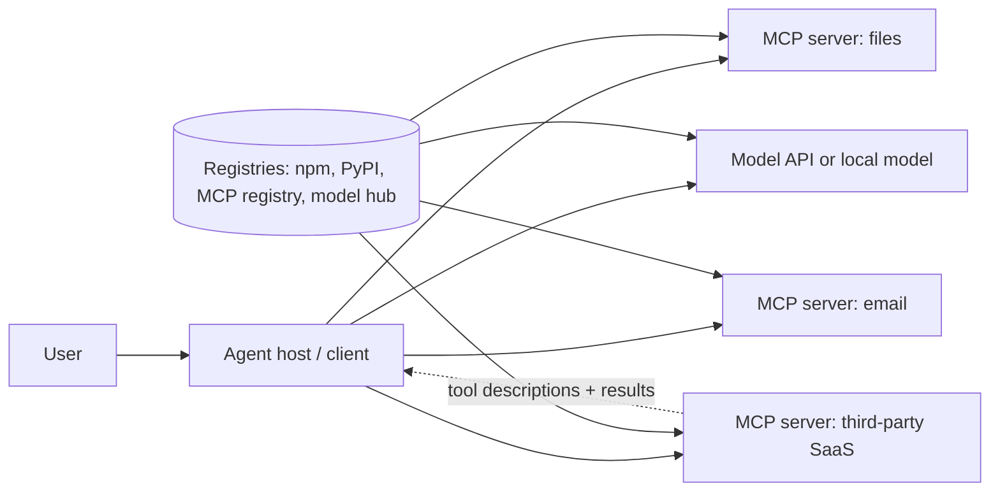

# What Your Agent Loads and Trusts

An AI agent is a language model wrapped in software that lets it call tools, read files, browse, run code and act on behalf of a user. Each of those abilities arrives through a dependency: a plugin, a Model Context Protocol (MCP) server, a package from a registry, a model checkpoint, a prompt template, a dataset used for retrieval. Many of these components are fetched at runtime, updated without review and given broad permissions. This book treats them as a software supply chain and applies the controls that supply-chain security has developed — inventory, provenance, pinning, signing, isolation and review — to the particular ways agents fail.

## Why agents are a special case

Traditional supply-chain attacks deliver malicious **code**. Agents add a second channel: malicious **text** that the model reads and acts on. A tool's description, a server's instructions, a README fetched by a coding agent or a document in a retrieval index can all steer the model. This means:

- A component can be harmful without containing any malicious executable code.
- The impact depends on what *other* tools the agent can use. A poisoned weather tool is dangerous mainly because the same agent can read files and send email.
- Updates to text are as security-relevant as updates to code, yet they are rarely reviewed.
- The agent itself may install dependencies (a coding agent running `pip install`), extending the chain at runtime.

## Inventory of trust

| Component | Typical source | What it can do if malicious |
|---|---|---|
| Base model or fine-tune | API provider, model hub | Biased or backdoored behaviour; unsafe formats can run code on load |
| MCP servers / plugins | npm, PyPI, GitHub, registries, vendor | Execute code locally; inject instructions via tool descriptions and results |
| Tool definitions (names, descriptions, schemas) | The server, at runtime | Steer model behaviour; shadow other tools |
| Agent framework and SDK | Package registries | Full code execution in the agent process |
| Prompt templates, system prompts, skills | Repos, shared libraries | Change policy, exfiltrate data via instructions |
| Retrieval corpora, memory stores | Internal and web data | Indirect prompt injection |
| Packages the agent installs | Registries, chosen by the model | Typosquats, hallucinated package names |
| Credentials passed to tools | Config files, env vars | Broad access if any tool is compromised |

Hallucinated package names deserve mention: models sometimes suggest dependencies that do not exist, and researchers have shown that attackers can register such names. The term "slopsquatting" is used for this pattern.

## A short history of the problem

Anthropic introduced MCP in November 2024 as an open protocol for connecting models to tools and data. Adoption across clients and vendors was fast, and so was security research. In 2025 Invariant Labs described **tool poisoning**, where hidden instructions in a tool's description manipulate the agent, and the related "rug pull" where a server changes its tool definitions after a user has approved it. Researchers also reported malicious MCP packages in public registries — for example, Koi Security reported in September 2025 that an npm package named `postmark-mcp` had added code in a later version to copy outgoing emails to an attacker-controlled address. Vulnerabilities in widely used MCP helper tools, such as a command-injection issue in `mcp-remote` disclosed by JFrog in 2025, showed that ordinary software bugs matter as much as prompt-level attacks.

These events follow a familiar supply-chain arc: rapid ecosystem growth, little vetting, high-privilege local execution and auto-updating dependencies.

## Relationship to other books

This book focuses on what agents load. **ai-agent-marketplace-security** covers marketplaces where agents and tools are listed and sold. **ml-model-supply-chain-security** goes deep on model artefacts, serialisation and training data. **ai-agent-wallet-security** covers agents that hold keys. **web3-supply-chain-security** covers package and front-end attacks in the Web3 ecosystem, many of which apply here.

## Worked example

*Execution status: the commands, code and numbers in this example were not executed in this book's CI; they are illustrative. Verify locally on a devnet, testnet or fork before relying on them.*

Inventory the supply chain of an agent setup on your own machine.

1. List every MCP server configured for your agent client. Most clients keep a JSON configuration listing each server's command and arguments (for example, `npx -y some-mcp-server` or `uvx some-server`).
2. For each entry, record: package name, registry, whether a version is pinned, the publisher, the date of the last release, and what credentials it receives through environment variables.
3. Note any entry using `npx -y` or `uvx` with no version: these fetch the latest release on each start.
4. List the tools each server exposes and mark which can read local data, which can send data out (HTTP, email, messaging), and which can execute code.
5. Draw lines between "reads sensitive data" tools and "sends data out" tools that share an agent. Each line is a potential exfiltration path if any one server is poisoned.
6. Rank servers by (privilege × update frequency × unknown publisher).

## Common pitfalls

- Treating tool descriptions as documentation rather than as input to the model.
- Unpinned `npx -y`/`uvx` launches that silently update.
- Giving every server the same broad API tokens.
- Letting coding agents install packages without allowlists.
- Inventories that list servers but not the tools and credentials behind them.

## Exercises

1. Complete the inventory for your setup and share it with a colleague for review.
2. For one MCP server you use, find its source repository, release process and maintainers, and decide whether you would accept it as a dependency in production code.
3. Ask a coding agent to scaffold a small project, then check every dependency it chose against the registry to confirm it exists and is the intended package.

## Further reading

- Model Context Protocol specification and documentation: <https://modelcontextprotocol.io>
- Invariant Labs, research posts on MCP tool poisoning (2025)
- OWASP Top 10 for LLM Applications (2025), including supply chain and prompt injection entries: <https://genai.owasp.org>
- Related books: **ml-model-supply-chain-security**, **ai-agent-marketplace-security**, **ai-agent-wallet-security**, **web3-supply-chain-security**
