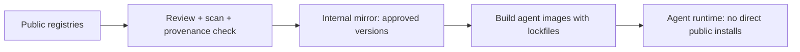

# Registries, Signing and Dependency Pinning

Agent components reach users through registries: npm and PyPI for most MCP servers and SDKs, container registries for packaged servers, model hubs for weights, and dedicated catalogues such as the official MCP Registry (launched in preview in September 2025). Registries make discovery easy and attack scale easy too. This chapter covers how to choose, verify and pin what you install, using controls that already exist in mainstream package ecosystems.

## What can go wrong at the registry

| Threat | Example pattern |
|---|---|
| Typosquatting / confusable names | `mcp-server-gihub` instead of `mcp-server-github` |
| Hallucinated names registered by attackers | A model suggests a non-existent package; someone publishes it |
| Account takeover of a maintainer | Malicious release pushed to a trusted package |
| Malicious update by an original author | The `postmark-mcp` case reported by Koi Security in 2025 |
| Dependency confusion | Public package with the same name as an internal one wins resolution |
| Compromised build pipeline | Release artefact differs from source |
| Install-time scripts | `postinstall` hooks run arbitrary code during `npm install` |

The general npm and PyPI threat landscape is covered in **web3-supply-chain-security**; agents add the twist that the dependency often runs with access to the user's files and credentials and is launched automatically by the agent client.

## Choosing components

Before adding a server or plugin, check:

- **Publisher identity.** Is it published by the vendor whose API it wraps, or by an unknown account? Registries increasingly support verified publishers and namespaces tied to domains or GitHub organisations; the MCP Registry, for example, ties server names to verified namespaces.
- **Source and build link.** Does the package link to a public repository, and can you tie the release to a commit?
- **Provenance attestations.** npm supports provenance statements generated in CI (`npm publish --provenance`), and PyPI supports Trusted Publishing and attestations. Their presence shows the package was built by a named CI workflow from a named repository.
- **Maintenance signals.** Release cadence, number of maintainers, issue response, OpenSSF Scorecard results.
- **Permissions needed.** Least privilege is easier when you choose servers that need less.

## Verifying signatures and provenance

```bash
# npm: verify registry signatures and provenance attestations for installed packages
npm audit signatures

# Containers: verify a Sigstore keyless signature tied to a CI identity
cosign verify ghcr.io/example/mcp-server@sha256:<digest> \
  --certificate-identity-regexp 'https://github.com/example/mcp-server/.github/workflows/release.yml@.*' \
  --certificate-oidc-issuer https://token.actions.githubusercontent.com
```

Signatures answer "who built this and from where?" They do not answer "is this safe?" A signed release from a compromised or malicious maintainer is still malicious. Use signing to make attacks attributable and to block tampering in transit, and review to judge content.

SLSA (Supply-chain Levels for Software Artifacts) gives a vocabulary for build integrity levels, and in-toto provides attestation formats; both apply unchanged to agent components.

## Pinning

Pinning turns "whatever is latest" into "exactly what we reviewed".

| Ecosystem | Pin by | Integrity |
|---|---|---|
| npm | exact version in `package.json`, committed `package-lock.json`, `npm ci` | `integrity` hashes in the lockfile |
| Python | `uv lock` / `pip-compile --generate-hashes` | `pip install --require-hashes -r requirements.txt` |
| Containers | image digest `@sha256:...` | Content-addressed |
| Models | commit hash / revision on the hub | File hashes, signatures (Chapter 5) |
| Remote MCP servers | Cannot pin code; pin tool-definition hash (Chapter 2) and contract terms | Change detection only |

For agent clients that launch servers with `npx` or `uvx`, a practical approach is to stop launching from the registry at runtime. Instead, install pinned versions into a dedicated directory or container image through your normal build process, review the lockfile diff, and point the client at the local binary.

Disable install scripts where possible (`npm ci --ignore-scripts`) and enable them only for packages that need them after review.

## Internal registry and allowlist

Organisations running many agents should operate an internal mirror or proxy (for example, a private npm/PyPI proxy or an internal MCP catalogue) containing only approved components and versions. Agents and developers install from the mirror; new additions go through review. This also blocks dependency confusion if the proxy is configured to prefer internal names.



## Worked example

*Execution status: the commands, code and numbers in this example were not executed in this book's CI; they are illustrative. Verify locally on a devnet, testnet or fork before relying on them.*

Convert an unpinned MCP launch into a pinned, verified install.

1. Start from a client configuration entry such as `{"command": "npx", "args": ["-y", "@modelcontextprotocol/server-filesystem", "/home/me/projects"]}`.
2. Create a directory `mcp-deps/`, run `npm init -y`, then `npm install --save-exact --ignore-scripts @modelcontextprotocol/server-filesystem@<version>` choosing a specific version after reading its changelog.
3. Commit `package.json` and `package-lock.json`. Run `npm audit signatures` and record whether signatures and provenance attestations verify.
4. Change the client entry to run the installed binary from `mcp-deps/node_modules/.bin/` with `npm ci --ignore-scripts` as the install step in your setup script.
5. Simulate an update: bump the version in a branch, review the lockfile diff and the package diff (`npm diff --diff=<old> --diff=<new>` for the package), and run the tool-definition pinning check from Chapter 2 before merging.
6. Repeat for one Python-based server using `uv` with a lockfile and `--require-hashes` export.

## Common pitfalls

- Treating a signature or provenance badge as a safety verdict.
- Lockfiles committed but `npm install` (not `npm ci`) used in automation.
- Letting agents install packages from public registries during tasks.
- Install scripts enabled by default.
- No owner for reviewing dependency updates, so they are merged blind or never.

## Exercises

1. Run `npm audit signatures` on a project with several MCP server dependencies and explain each result.
2. Set up a local PyPI proxy (for example devpi) and configure a Python agent to install only from it.
3. Write a CI check that fails if any agent configuration launches a server without an exact version or digest.

## Further reading

- npm provenance documentation: <https://docs.npmjs.com/generating-provenance-statements>
- PyPI Trusted Publishing and attestations: <https://docs.pypi.org>
- Sigstore and cosign: <https://www.sigstore.dev>
- SLSA: <https://slsa.dev>; in-toto: <https://in-toto.io>
- MCP Registry: <https://github.com/modelcontextprotocol/registry>
- Related books: **web3-supply-chain-security**, **ml-model-supply-chain-security**
