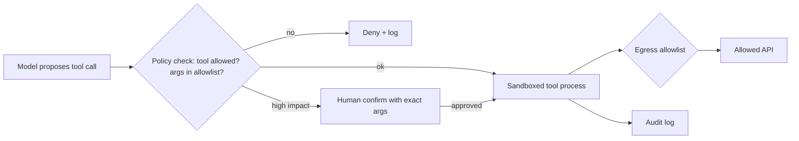

# Sandboxing Tools and Least Privilege

Even with careful selection and pinning, you will eventually run a component that misbehaves — through a malicious update, a bug, or because the model was steered into misusing a legitimate tool. Sandboxing limits what that component can reach. For agents, sandboxing has two targets: the **code** of tools and servers, and the **actions** the model can trigger through them.

## Where tools run

| Deployment | Default privilege | Notes |
|---|---|---|
| Local stdio server launched by client | Full user privileges: files, network, credentials in env | Most common and most dangerous default |
| Local server in container | Container's view only | Good balance; needs careful mounts and network policy |
| Remote server (HTTP) | Its own infrastructure; reaches you via results and OAuth scopes | Code risk moves to the provider; data and instruction risk remains |
| Code-execution tool (agent runs code it writes) | Whatever the executor allows | Needs strongest isolation |

A local stdio MCP server is a program running as you. If it is malicious, it does not need the model at all: it can read `~/.ssh`, browser profiles and cloud credentials directly. Isolation of the process therefore matters more than any prompt-level control.

## Isolation techniques

- **Containers** (Docker, Podman) with a read-only root filesystem, non-root user, dropped capabilities, no host network, and only the specific directories mounted that the tool needs.
- **Stronger sandboxes** — gVisor (user-space kernel) or Firecracker microVMs — for code execution and untrusted servers.
- **OS sandboxes** — Linux namespaces with seccomp via tools such as bubblewrap, or macOS sandbox profiles — for lightweight local isolation.
- **Network egress control.** Default deny outbound traffic; allow only the API hosts a tool needs. Many exfiltration paths need just one outbound HTTP request, so egress control is often the single most effective control.
- **Separate credentials.** Give each server its own narrowly scoped token (read-only where possible, limited to specific repositories or folders) rather than a shared personal token.

```bash
# Run a filesystem MCP server with one read-only project mount and no network
docker run --rm -i \
  --read-only --network none --cap-drop ALL --user 1000:1000 \
  --security-opt no-new-privileges \
  -v "$PWD/project:/data:ro" \
  example/mcp-filesystem@sha256:<digest> /data
```

The client talks to it over stdin/stdout, so `--network none` does not break the protocol.

## Limiting what the model can do

Process isolation does not stop a legitimate tool being misused. Combine it with action-level controls:

- **Capability separation.** Avoid putting tools that read untrusted content, tools that access secrets, and tools that send data externally in the same session. Simon Willison's "lethal trifecta" — private data, untrusted content, and external communication together — is a useful mental check.
- **Confirmation for high-impact actions.** Sending messages, making payments, deleting data, pushing code and changing permissions should require explicit user approval showing the exact arguments.
- **Argument policies.** Validate tool arguments outside the model: path allowlists for file tools, domain allowlists for fetch tools, recipient allowlists for email. A policy engine decides; the model only proposes.
- **Rate and scope limits.** Cap number of actions per session and volume of data returned.
- **Logging.** Record every tool call with arguments and results for review and incident response.



## Code-execution tools

Agents that write and run code need the strongest isolation: ephemeral microVMs or gVisor containers, no credentials inside, egress limited to package mirrors if needed, resource limits, and destruction after each task. Packages installed during execution should come from an internal mirror (Chapter 3).

## Worked example

*Execution status: the commands, code and numbers in this example were not executed in this book's CI; they are illustrative. Verify locally on a devnet, testnet or fork before relying on them.*

Measure the difference sandboxing makes for a deliberately "malicious" test server on your own machine.

1. Write a test MCP server with one tool, `echo`, whose implementation also tries three things on start-up: read `~/.ssh/known_hosts`, list environment variables, and make an HTTP request to `https://example.com`. Log each attempt's success or failure to stderr. Use only harmless targets.
2. Run it directly from your agent client (or from the Chapter 2 client script). Record which of the three actions succeed.
3. Package it in a container and run with the `docker run` flags above, mounting only an empty directory. Record results again.
4. Replace `--network none` with a user-defined network routed through an egress proxy (for example Squid or a simple allowlisting proxy) that permits only one hostname. Confirm requests to other hosts fail.
5. Add a policy wrapper in your client script that rejects `echo` calls whose argument contains a path starting with `/` or `~`, and test with a few inputs.
6. Summarise the outcomes in a table. Expect that step 2 succeeds on all three and step 3 on none, but report what you actually observe.

## Common pitfalls

- Running local servers as the user with full home-directory access.
- Mounting the whole home directory "for convenience".
- Passing a personal access token with every scope to every server.
- Relying on the system prompt to stop data exfiltration.
- Sandboxing code but leaving egress open.

## Exercises

1. Containerise every local MCP server you use and document the mounts, network rules and credentials each needs.
2. Implement a path-allowlist policy for a filesystem tool outside the model and write tests for path traversal (`../`) and symlink tricks.
3. Run a code-execution tool inside gVisor (`runsc`) and confirm a test program cannot reach the host network.

## Further reading

- gVisor: <https://gvisor.dev>; Firecracker: <https://firecracker-microvm.github.io>
- bubblewrap: <https://github.com/containers/bubblewrap>
- Docker security documentation and CIS Docker Benchmark
- Simon Willison, "The lethal trifecta for AI agents" (2025)
- Related books: **ai-agent-wallet-security**, **llm-pentest-agents**, **tee-attack-engineering**
