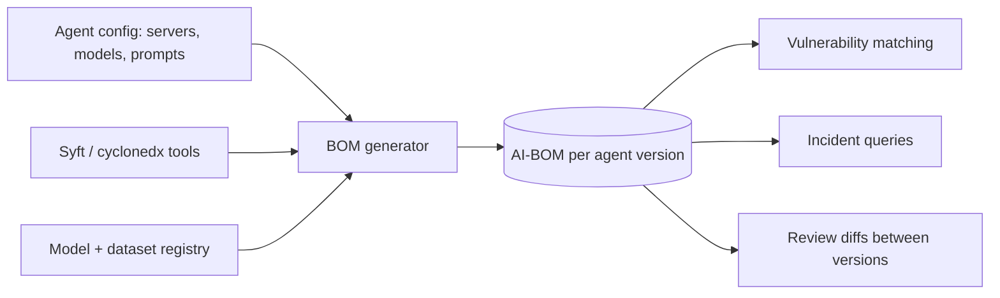

# Model and Dataset Provenance, SBOM and AI-BOM

An agent's behaviour depends on more than its code: the model weights, the fine-tuning data, embedding models, retrieval corpora and prompt assets all shape what it does. When something goes wrong — a vulnerable package, a backdoored model, a poisoned dataset, a leaked prompt — you need to know quickly which agents are affected. That requires provenance (where each artefact came from and how it was produced) and a bill of materials (what each agent is made of). This chapter covers both at the level an agent operator needs; **ml-model-supply-chain-security** goes deeper on model artefacts.

## Model and dataset provenance in brief

Key risks for model artefacts:

- **Unsafe serialisation.** Python pickle-based formats can execute code when loaded. Prefer `safetensors` for weights and scan pickle files (for example with `picklescan` or `modelscan`) if you must use them.
- **Tampered or substituted weights.** A model on a hub can be replaced by a new commit; a lookalike repository can host a modified copy.
- **Backdoors and poisoning.** Behaviour triggered by specific inputs, introduced in training or fine-tuning data.
- **Unclear licences and data origins.** Legal and compliance risk, and inability to judge contamination.

Controls:

- Pin models by immutable revision (commit hash on a hub, or digest in your own store), never by a moving name.
- Verify signatures where available. The OpenSSF model signing project (`model-signing`, built on Sigstore) provides tooling to sign and verify model directories.
- Record dataset sources, versions and hashes for any fine-tuning or retrieval corpus you build.
- For API-hosted models, record provider, model identifier and version or snapshot date; behaviour can change when providers update aliases.

## SBOM for agents

A Software Bill of Materials lists the software components in a product. The two main formats are **SPDX** (Linux Foundation; SPDX 3.0 added AI and Dataset profiles) and **CycloneDX** (OWASP; version 1.5 introduced machine-learning BOM support, often called ML-BOM). Both can describe models and datasets alongside packages.

For an agent, a useful "AI-BOM" covers:

| Section | Contents |
|---|---|
| Runtime software | Agent framework, SDKs, client version, OS packages (generated by SCA tools) |
| Tools | MCP servers and plugins: name, version or digest, publisher, source, tool-definition hash, granted credentials and scopes |
| Models | Provider or hub, identifier, revision/digest, format, licence, signature status |
| Data | Retrieval corpora and fine-tuning sets: source, version, hash, owner |
| Prompts and policies | System prompt and template versions (hash), policy files |
| Runtime controls | Sandbox profile, egress allowlist reference |

Not all of this has a standard field yet. Use standard fields where they exist and documented custom properties elsewhere, and keep the format machine-readable so it can be queried.

```json
{
  "bomFormat": "CycloneDX",
  "specVersion": "1.6",
  "components": [
    { "type": "application", "name": "mcp-server-filesystem", "version": "x.y.z",
      "purl": "pkg:npm/%40modelcontextprotocol/server-filesystem@x.y.z",
      "properties": [
        { "name": "agent:toolDefinitionSha256", "value": "3f1a..." },
        { "name": "agent:credentialScopes", "value": "fs:/data:ro" } ] },
    { "type": "machine-learning-model", "name": "example-embedding-model",
      "version": "<hub-commit-hash>" }
  ]
}
```

The `agent:` property names here are illustrative conventions, not part of the standard.

## Generating and using the BOM

- Generate software components with existing tools such as Syft or `cyclonedx-npm` / `cyclonedx-py`.
- Merge in tool, model and data entries from your agent configuration and model registry with a small script.
- Store BOMs per agent version and per deployment.
- Feed them to vulnerability tooling (for example Grype or OSV-Scanner for packages) and to your own queries: "which agents load server X version Y?", "which agents use model revision Z?".



The BOM also makes reviews concrete: diffing the BOMs of two agent versions shows exactly which servers, models, prompts and scopes changed.

## Using AI in this process

Models can help draft BOM entries from configuration files or summarise licence texts. Treat these as drafts: every hash and version must come from the artefact itself (computed by a script), and licence conclusions need human or legal review. The script that computes hashes is the checker.

## Worked example

*Execution status: the commands, code and numbers in this example were not executed in this book's CI; they are illustrative. Verify locally on a devnet, testnet or fork before relying on them.*

Produce an AI-BOM for the agent set up in earlier chapters.

1. Run `syft dir:./mcp-deps -o cyclonedx-json > software.json` to inventory npm dependencies of your pinned servers.
2. Write a Python script that reads your agent client's server configuration, runs the Chapter 2 fingerprint function for each server, and emits CycloneDX components with tool-definition hashes and credential scopes as properties.
3. Add model entries: for a local embedding model, record its hub repository and commit hash and compute SHA-256 of each weight file; for an API model, record the provider and model identifier.
4. Merge into `agent-bom.json` and validate it with the CycloneDX CLI (`cyclonedx validate`), noting any schema errors.
5. Run `grype sbom:./software.json` or `osv-scanner` against the software portion and triage any findings.
6. Change one server version, regenerate, and diff the two BOMs with `jq` to produce a human-readable change list.

## Common pitfalls

- SBOMs that list packages but not tools, models, prompts or scopes.
- Model references by name only, with no revision or digest.
- Loading pickle-format weights from unknown sources.
- Generating a BOM once for compliance and never using it.
- Copying AI-drafted hashes or versions without computing them.

## Exercises

1. Extend your BOM generator to include system prompt hashes and fail CI if a prompt changes without a reviewed entry.
2. Sign a local model directory with the OpenSSF `model-signing` tool and verify it, then modify a file and confirm verification fails.
3. Write a query that answers "which agents would be affected if server X were found malicious?" from a folder of BOMs.

## Further reading

- CycloneDX (including ML-BOM): <https://cyclonedx.org>
- SPDX 3.0 (AI and Dataset profiles): <https://spdx.dev>
- OpenSSF model signing: <https://github.com/sigstore/model-transparency>
- safetensors: <https://github.com/huggingface/safetensors>
- Syft and Grype: <https://github.com/anchore/syft>, <https://github.com/anchore/grype>
- Related books: **ml-model-supply-chain-security**, **verifiable-ai-inference**, **synthetic-vulnerability-datasets**
