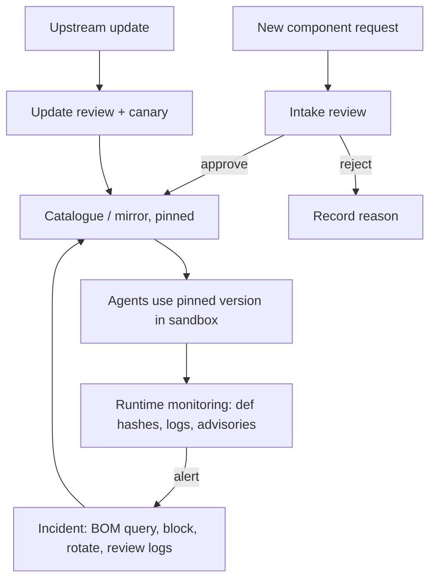

# A Review Process and Supply Chain Checklist

The controls in this book only work if someone applies them consistently: deciding which components are allowed, reviewing updates, watching for changes and responding when something turns bad. This chapter describes a lightweight review process suitable for a small team and scalable to an organisation, followed by a checklist.

## Roles and scope

Name an owner for agent supply chain security. Define scope explicitly: which agent clients, which teams, which environments (developer laptops, CI agents, production agents). Developer laptops are often the weakest point, because individuals add MCP servers to their own clients with personal credentials.

## Intake review

Every new component — MCP server, plugin, SDK, model, dataset, prompt library — passes an intake review before use.

| Question | Evidence |
|---|---|
| Who publishes it and how is the publisher verified? | Registry namespace, organisation, domain |
| Is the source available and does the release match it? | Repository link, provenance attestation, reproducible build where possible |
| What does it need? | Credentials, scopes, file paths, network hosts |
| What do its tool definitions say? | Full text reviewed; definition hash recorded |
| Does it combine sensitive data, untrusted content and outbound communication? | Capability analysis |
| How is it isolated? | Sandbox profile, egress allowlist |
| How will updates be handled? | Pinned version, update owner, review cadence |
| Licence and data terms? | Licence, provider terms, data retention |

Record the decision with the evidence. Approved components go into the internal mirror or catalogue (Chapter 3).

## Update review

Updates are where rug pulls and account takeovers land. For each update:

1. Read the changelog and the code diff (or at least the diff of files that run on start-up and handle network or file access).
2. Diff tool definitions using the fingerprint tool from Chapter 2.
3. Check provenance and signatures for the new release.
4. Re-run any automated scans.
5. Diff the AI-BOM (Chapter 5) and confirm only expected changes.
6. Roll out to a canary group first.

Automated tools — including AI reviewers — can summarise diffs and flag suspicious changes such as new network calls, obfuscated code or instructions in descriptions. Their role is to propose; the decision belongs to the reviewer, who verifies each flagged item in the actual diff, and the definition-hash and provenance checks, which are deterministic.

## Continuous monitoring

- Alert on tool-definition hash changes at runtime.
- Watch advisories for components in your BOMs (OSV, GitHub Security Advisories, vendor notices).
- Log all tool calls centrally with server, tool, arguments (redacted where necessary) and outcome.
- Periodically re-scan configurations on developer machines, for example through endpoint management.

## Incident response for agent components

When a component is reported malicious or vulnerable:

1. Query BOMs to find affected agents and users.
2. Block the component version in the mirror and disable it in client configurations.
3. Revoke and rotate every credential that the component could access.
4. Review tool-call logs for the exposure window.
5. Notify affected users and, where relevant, the registry and publisher.

## Worked example

*Execution status: the commands, code and numbers in this example were not executed in this book's CI; they are illustrative. Verify locally on a devnet, testnet or fork before relying on them.*

Run an intake review on one real, public MCP server of your choice, on your own machine.

1. Pick an MCP server from the official MCP Registry or a vendor's repository.
2. Fill in the intake table above with evidence, including links to the repository, the publisher's namespace and any provenance attestation (`npm view <pkg> --json` or the registry page).
3. Install the pinned version into `mcp-deps/` with scripts disabled. Fingerprint its tool definitions and read every description in full.
4. Run it in the container profile from Chapter 4, grant the narrowest credential that still lets it work, and confirm it functions.
5. Optionally ask an AI assistant to review the package source for network calls and file access. For each claim it makes, locate the line in the source and mark it confirmed or not. Record the confirmation rate.
6. Write the decision: approve, approve with conditions, or reject, with reasons.

## Checklist

**Inventory and policy**

- [ ] Owner named; scope defined (laptops, CI, production).
- [ ] Inventory of all agent clients, servers, plugins, models, datasets and prompts.
- [ ] AI-BOM generated per agent version and stored.

**Selection and installation**

- [ ] Intake review recorded for every component.
- [ ] Verified publishers and provenance where available.
- [ ] Exact versions or digests pinned; lockfiles committed; install scripts off by default.
- [ ] Installs come from an internal mirror; agents cannot install from public registries at runtime.

**Runtime**

- [ ] Tool-definition hashes pinned; changes block start-up until reviewed.
- [ ] Servers sandboxed with minimal mounts and egress allowlists.
- [ ] Per-server scoped credentials.
- [ ] Confirmation for high-impact actions; argument policies enforced outside the model.
- [ ] Central logging of tool calls.

**Change and response**

- [ ] Update review with diff, definition diff, provenance and canary.
- [ ] Advisory monitoring mapped to BOMs.
- [ ] Incident runbook: block, rotate, review logs, notify.

## Common pitfalls

- Reviewing new components but auto-accepting their updates.
- Ignoring developer laptops because "production is locked down".
- Treating an AI reviewer's clean summary as approval.
- Credential rotation forgotten after removing a compromised server.
- A checklist with no evidence attached to each item.

## Exercises

1. Complete the worked example for two servers and compare how long each review took.
2. Write a script that checks every developer's agent client configuration against the approved catalogue and reports drift.
3. Run a tabletop: "a popular MCP server you use is reported to exfiltrate tokens since its last release". Time each response step.

## Further reading

- OWASP Top 10 for LLM Applications (2025): <https://genai.owasp.org>
- NIST AI Risk Management Framework (AI RMF 1.0) and the Generative AI Profile (NIST AI 600-1)
- OpenSSF Scorecard: <https://scorecard.dev>
- Related books: **ai-agent-marketplace-security**, **ml-model-supply-chain-security**, **web3-supply-chain-security**, **ai-agent-wallet-security**
